<picture>
  <source media="(prefers-color-scheme: dark)" srcset="art/banner-dark.svg">
  
</picture>

  <a href="https://sweaxstudios.xyz"><b>sweaxstudios.xyz</b></a>
  &nbsp;&nbsp;·&nbsp;&nbsp;
  <a href="https://github.com/Sweax3169/sweaxmorph">SweaxMorph</a>
  &nbsp;&nbsp;·&nbsp;&nbsp;
  <a href="https://github.com/Sweax3169/sweaxclip">SweaxClip</a>
  &nbsp;&nbsp;·&nbsp;&nbsp;
  <a href="https://github.com/Sweax3169/sweaxcut">SWEAXCUT</a>
  &nbsp;&nbsp;·&nbsp;&nbsp;
  <a href="https://discord.gg/vGZ2DZZsrf">Discord</a>

 

I'm an independent developer from Türkiye, working as **Sweax Studios**. I build native Windows software, audio plugins, Roblox games and web platforms, and I take each one all the way to release — code, interface, installer, tests and documentation. I also produce rap beats, which is why some of my tools are about sound.

 

## Featured

<a href="https://github.com/Sweax3169/sweaxmorph">
  <picture>
    <source media="(prefers-color-scheme: dark)" srcset="art/sweaxmorph-dark.svg">
    
  </picture>
</a>

**[SweaxMorph](https://github.com/Sweax3169/sweaxmorph)** is a file converter for Windows that lives one shortcut away. Morph, a little gel creature, opens its mouth when you carry files near it, swallows them, takes on their colour and grows a ring of petals: the formats they can become. Press <kbd>Win</kbd> + <kbd>Alt</kbd> + <kbd>F</kbd>, tap <kbd>Space</kbd> while dragging in Explorer, or right-click a file. Images, video, audio, documents, slides, PDF, e-books, data, archives, subtitles and fonts: 126 formats, all offline.

  <picture>
    <source media="(prefers-color-scheme: dark)" srcset="art/sweaxmorph-demo-dark.gif">
    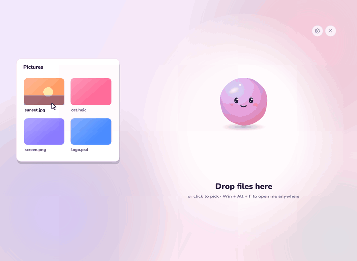
  </picture>

<table>
<tr>
<td width="50%" valign="top">

**Inside**
- A route planner over 14 converters: when no tool goes straight there, it chains up to three (PowerPoint → PDF → PNG)
- ImageMagick, FFmpeg, Pandoc, Office and LibreOffice, Windows PDF and OCR
- WOFF/WOFF2 fonts, archives and JSON/YAML/TOML/XML/CSV/Excel written in-house
- Morph is drawn by hand every frame on a spring-physics gel body

</td>
<td width="50%" valign="top">

**Shipped with**
- A self-test that makes sample files and runs about a hundred real conversions
- README media recorded by the app itself, frame by frame
- English and Turkish, light and dark
- A [website](https://sweax3169.github.io/sweaxmorph/) where a live Morph reacts to files you drop on the page

</td>
</tr>
</table>

[Download](https://github.com/Sweax3169/sweaxmorph/releases/latest) · [Website](https://sweax3169.github.io/sweaxmorph/) · [Source](https://github.com/Sweax3169/sweaxmorph)

 

<a href="https://github.com/Sweax3169/sweaxclip">
  <picture>
    <source media="(prefers-color-scheme: dark)" srcset="art/sweaxclip-dark.svg">
    
  </picture>
</a>

**[SweaxClip](https://github.com/Sweax3169/sweaxclip)** replaces <kbd>Win</kbd> + <kbd>V</kbd> on Windows with a history that never forgets. Everything you copy — text, links, code, colours, images, screenshots, files — is kept on your own disk and comes back as a timeline right under your text cursor. Screenshots are searchable by the words inside them through the Windows OCR engine, and the whole thing waits in the tray at about 10 MB.

<table>
<tr>
<td width="50%" valign="top">

**Inside**
- Native C# / WPF on .NET 9, talking to Win32 directly
- SQLite in WAL mode with an FTS5 trigram index
- Low-level keyboard hook and accessibility caret lookup
- Spring physics for every movement in the panel

</td>
<td width="50%" valign="top">

**Shipped with**
- Self-contained single-file build from GitHub Actions
- English and Turkish, light and dark
- README media rendered by the app itself
- A [website](https://sweax3169.github.io/sweaxclip/) with a working copy of the panel

</td>
</tr>
</table>

[Download](https://github.com/Sweax3169/sweaxclip/releases/latest) · [Website](https://sweax3169.github.io/sweaxclip/) · [Source](https://github.com/Sweax3169/sweaxclip)

 

<a href="https://github.com/Sweax3169/sweaxcut">
  <picture>
    <source media="(prefers-color-scheme: dark)" srcset="art/sweaxcut-dark.svg">
    
  </picture>
</a>

**[SWEAXCUT](https://github.com/Sweax3169/sweaxcut)** is a timeline video editor for Windows, made for people who cut gameplay clips, Shorts and YouTube videos. Version 3 was redrawn from scratch. Drop clips on a recipe and the edit builds itself: a beat-cut montage, a talking video with captions, game highlights. Captions are written word by word on your own PC, edited like a document and restyled live, and the preview and the export are drawn by the same WebGL2 compositor.

  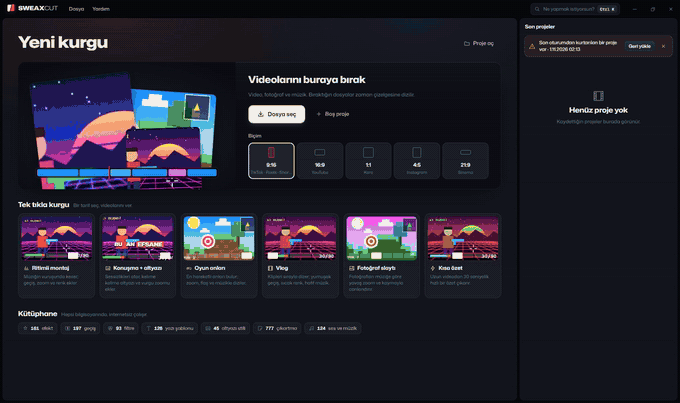

<table>
<tr>
<td width="50%" valign="top">

**Inside**
- Six one-click recipes, an eight-step "Polish" and eight looks; Ctrl+K reaches every tool
- whisper.cpp captions you can split, merge, retime and restyle, with 45 styles plus your own
- 197 transitions, 161 effects, 93 colour filters and 137 clip animations, all GLSL
- Keyframes with a bezier curve editor, colour scopes, and hardware export (NVENC, AMF, Quick Sync)

</td>
<td width="50%" valign="top">

**Shipped with**
- 777 stickers, 126 text templates and 101 fonts that all contain the Turkish letters
- 22 music tracks and 102 sound effects synthesised by the app
- An installer that carries every third-party licence, with source links in the release notes
- A [website](https://sweax3169.github.io/sweaxcut/) with a small editor that runs the app's own transition shaders

</td>
</tr>
</table>

[Download](https://github.com/Sweax3169/sweaxcut/releases/latest) · [Website](https://sweax3169.github.io/sweaxcut/) · [Source](https://github.com/Sweax3169/sweaxcut)

 

<a href="https://github.com/Sweax3169/sweaxterrain">
  <picture>
    <source media="(prefers-color-scheme: dark)" srcset="art/sweaxterrain-dark.svg">
    
  </picture>
</a>

**[Sweax Terrain](https://github.com/Sweax3169/sweaxterrain)** is a terrain plugin for Roblox Studio. Nine biomes blend into each other by weight, with lakes, rivers, an ocean edge and caves; a brush or a two-corner box erases any terrain in the place; 44 structures and 10 landforms drop onto the ground behind a see-through preview. Every step is one <kbd>Ctrl</kbd> + <kbd>Z</kbd>, and the panel speaks English and Turkish.

  <picture>
    <source media="(prefers-color-scheme: dark)" srcset="art/sweaxterrain-demo-dark.gif">
    
  </picture>

<table>
<tr>
<td width="50%" valign="top">

**Inside**
- A two-pass generator: a domain-warped height map, then materials, rock outcrops and caves per voxel, written in 24 × 24 column parcels
- 2048 × 2048 studs in one run; 512 × 512 takes 0.30 s
- 54 structures and landforms built from plain parts, so there is nothing to upload

</td>
<td width="50%" valign="top">

**Shipped with**
- A JavaScript port of the generator that matches Studio column for column (238,848 columns checked)
- README art drawn from real plugin output: voxels read back from Studio and rendered in Blender
- A [website](https://sweax3169.github.io/sweaxterrain/) where the plugin's own panel and generator run in the browser

</td>
</tr>
</table>

[Download](https://github.com/Sweax3169/sweaxterrain/releases/latest) · [Website](https://sweax3169.github.io/sweaxterrain/) · [Source](https://github.com/Sweax3169/sweaxterrain)

 

<a href="https://github.com/Sweax3169/sweaxnext">
  <picture>
    <source media="(prefers-color-scheme: dark)" srcset="art/sweaxnext-dark.svg">
    
  </picture>
</a>

**[SweaxNext](https://github.com/Sweax3169/sweaxnext)** is a VST3 plug-in that mixes rap vocals. Put it on the vocal channel, press analyse and play the verse. It measures every phrase and names what is wrong (mic pops, harsh esses, room noise, hum, lines recorded at different levels), builds a chain for one of 16 styles, renders that chain offline on what it heard, measures again, and then hands you the result as ordinary parameters you can tweak, automate and undo.

  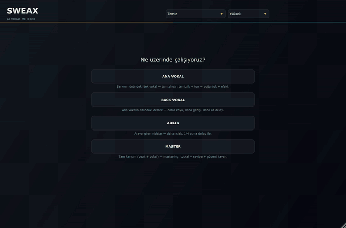

<table>
<tr>
<td width="50%" valign="top">

**Inside**
- 20 modules in C++ on JUCE, from a gate and a true-peak limiter to spectral resonance smoothing and formant shift
- 22 problem checks, a rule-based planner with its own chain order per style, and an offline render-and-measure loop
- An audio thread that never waits, locks or allocates; analysis and planning run on their own threads
- Latency fixed per quality mode and reported to the host

</td>
<td width="50%" valign="top">

**Shipped with**
- 159 automated tests and pluginval at strictness 10
- A demo take built from scratch (synthetic voice, synthesised beat) rendered through all 16 styles
- README pictures and videos drawn by the plug-in itself, off-screen
- A [website](https://sweax3169.github.io/sweaxnext/) where you switch styles and A/B the real renders over a beat

</td>
</tr>
</table>

[Download](https://github.com/Sweax3169/sweaxnext/releases/latest) · [Website](https://sweax3169.github.io/sweaxnext/) · [Source](https://github.com/Sweax3169/sweaxnext)

 

## Selected work

<table>
<tr>
<td width="50%">
<a href="https://github.com/Sweax3169/sweaxmorph"><picture><source media="(prefers-color-scheme: dark)" srcset="art/card-sweaxmorph-dark.svg">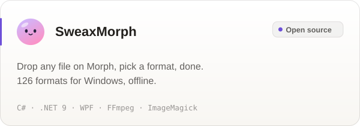</picture></a>
</td>
<td width="50%">
<a href="https://github.com/Sweax3169/sweaxclip"><picture><source media="(prefers-color-scheme: dark)" srcset="art/card-sweaxclip-dark.svg">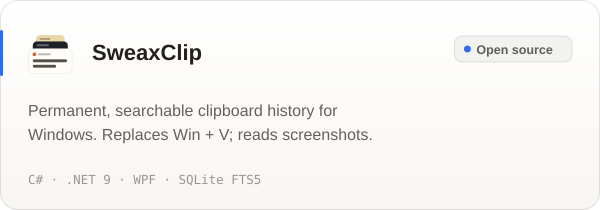</picture></a>
</td>
</tr>
<tr>
<td width="50%">
<a href="https://github.com/Sweax3169/sweaxcut"><picture><source media="(prefers-color-scheme: dark)" srcset="art/card-sweaxcut-dark.svg">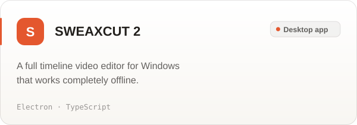</picture></a>
</td>
<td width="50%">
<a href="https://github.com/Sweax3169/sweaxnext"><picture><source media="(prefers-color-scheme: dark)" srcset="art/card-sweaxnext-dark.svg">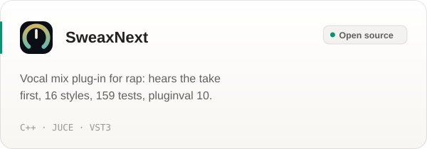</picture></a>
</td>
</tr>
<tr>
<td width="50%">
<a href="https://github.com/Sweax3169/sweaxbeacon"><picture><source media="(prefers-color-scheme: dark)" srcset="art/card-sweaxbeacon-dark.svg">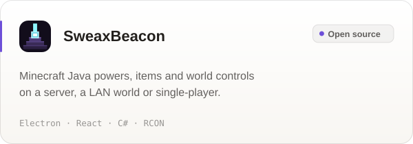</picture></a>
</td>
<td width="50%">
<a href="https://github.com/Sweax3169/sweaxterrain"><picture><source media="(prefers-color-scheme: dark)" srcset="art/card-sweaxterrain-dark.svg">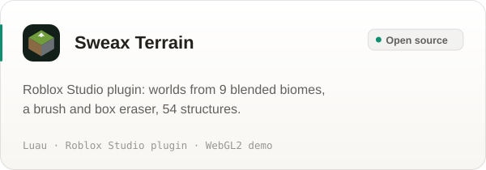</picture></a>
</td>
</tr>
<tr>
<td colspan="2" align="center">
<a href="https://sweax3169.github.io/roblox-games/"><picture><source media="(prefers-color-scheme: dark)" srcset="art/card-robloxgames-dark.svg">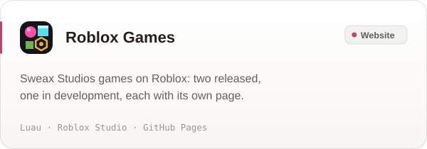</picture></a>
</td>
</tr>
</table>

<b>More projects</b>

 

| Project | What it is | Built with | Status |
| --- | --- | --- | --- |
| Sweax Rhythm Trainer | Metronome, tap tempo and auto-quantize for practising timing | C++, JUCE | VST3 |

 

## How I work

- **All the way to release.** A project isn't done when it runs on my machine. It is done when it has an installer, a page that explains it and a build anyone can check.
- **Measured, not guessed.** SWEAX NEXT runs 159 automated tests and passes pluginval at its strictest level; SweaxMorph converts about a hundred real sample files before a release; SweaxClip's memory use is measured on a real machine before a number goes in its README.
- **Interfaces with their own character.** Each product gets a look that comes from what it is — SweaxClip's panel is a timeline of your clips, SweaxMorph is a creature that eats files.

 

## Tools

  
  
  
  
  
  
  
  
  
  
  
  
  

 

Sweax Studios · Türkiye · <a href="https://sweaxstudios.xyz">sweaxstudios.xyz</a>

