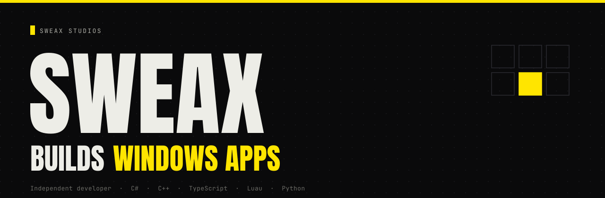
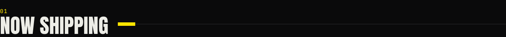
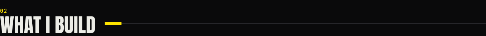
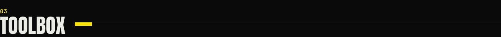
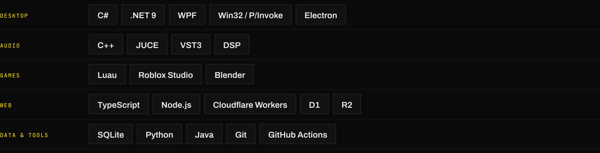
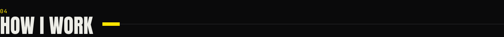

  

  
  
  

I'm Sweax, an independent developer from Türkiye working under **Sweax Studios**. I build complete products end to end — the code, the interface, the installer, the docs — across Windows software, audio plugins, Roblox games and web platforms. I also produce rap beats, which is why half my tools end up being about sound.

 

**[SweaxClip](https://github.com/Sweax3169/sweaxclip)** — a clipboard that never forgets. It replaces <kbd>Win</kbd> + <kbd>V</kbd> with a permanent, searchable archive of everything you copy: text, links, code, colors, images, screenshots and files. Screenshots are searchable by the words inside them (offline OCR), and the app uses about 6 MB of memory while it waits in the tray.

`C#` `.NET 9` `WPF` `Win32` `SQLite FTS5` `Windows OCR` · [Download](https://github.com/Sweax3169/sweaxclip/releases/latest) · [Website](https://sweax3169.github.io/sweaxclip/) · [Source](https://github.com/Sweax3169/sweaxclip)

 

<table>
<tr>
<td width="50%" valign="top">

### Desktop software

**SweaxClip** &nbsp;`open source` 
Permanent clipboard archive for Windows with OCR search, a contact-sheet library and daily snapshots. 
`C#` `WPF` `Win32 hooks` `SQLite`

**SWEAXCUT 2** &nbsp;`desktop app` 
Timeline video editor for Windows that works fully offline: import, cut, layer and export. 
`Electron` `TypeScript`

**SweaxPanel** &nbsp;`desktop app` 
Control panel for Minecraft servers over RCON — six tabs, tested against Paper 1.21. 
`Electron` `RCON`

</td>
<td width="50%" valign="top">

### Audio plugins

**SWEAX NEXT** &nbsp;`VST3` 
Vocal mixing plugin for rap vocals: 12 ready-made vocal chains, formant and de-harsh controls, reverb types and saturation characters. 159 automated tests; passes pluginval at strictness 10. 
`C++` `JUCE` `DSP`

**Sweax Rhythm Trainer** &nbsp;`VST3` 
Metronome, tap tempo and auto-quantize for practising timing. 
`C++` `JUCE`

**Sweax Beatmaker** &nbsp;`VST3` 
Beat maker plugin for making drums inside the DAW. 
`C++` `JUCE`

</td>
</tr>
<tr>
<td width="50%" valign="top">

### Roblox games

**+1 Speed POP IT** &nbsp;`released` 
Pop-it game with session-locked saves (ProfileStore) and a mobile system that keeps 70,000+ parts out of replication so phones stay fast. 
`Luau` `DataStores` `performance`

**RNG Zombie Defense** &nbsp;`in development` 
Wave defense with 40 waves, 11 themes, 17 languages and a layered weapon-skin system. 
`Luau` `localisation` `UI`

**Maden Farm** &nbsp;`in development` 
Mining tycoon where ore physics run on each client at 60 FPS while the server keeps the ledger. 
`Luau` `client/server design`

**Classrooms of the Locust** · **Kar Ekspresi** &nbsp;`in development` 
A horror game with a fully rigged boss and VHS camera UI; a co-op steam-train survival game. 
`Luau` `Blender`

</td>
<td width="50%" valign="top">

### Web platforms

**[sweaxstudios.xyz](https://sweaxstudios.xyz)** &nbsp;`live` 
The studio's website. 
`Cloudflare` `JavaScript`

**Adana Mücadele** &nbsp;`live` 
Website and member platform for an MMA club, running in production with real members. 
`Cloudflare Workers` `D1` `Durable Objects` `R2`

### Creator tools

**Sweax Terrain** &nbsp;`Roblox Studio plugin` 
Terrain generator and eraser with 9 biomes and 8 ready-made worlds. 
`Luau` `procedural generation`

**Detail Brush** &nbsp;`Roblox Studio plugin` 
Paints models and details onto surfaces. 
`Luau`

</td>
</tr>
</table>

 

 

- **Finished, not just working.** A project is done when it has an installer, a README, screenshots and a build that anyone can reproduce.
- **Measured.** I put numbers in the docs — memory at idle, frames per second, test counts — and keep them true.
- **The lightest stack that does the job.** Native when it has to sit in the background; web tech when it has to ship fast.
- **More than one language.** SweaxClip ships in English and Turkish; RNG Zombie Defense in 17 languages.

 

