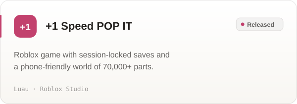
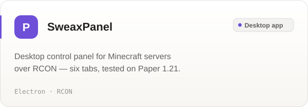
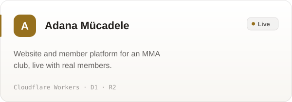

<picture>
  <source media="(prefers-color-scheme: dark)" srcset="art/banner-dark.svg">
  
</picture>

  <a href="https://sweaxstudios.xyz"><b>sweaxstudios.xyz</b></a>
  &nbsp;&nbsp;·&nbsp;&nbsp;
  <a href="https://github.com/Sweax3169/sweaxmorph">SweaxMorph</a>
  &nbsp;&nbsp;·&nbsp;&nbsp;
  <a href="https://github.com/Sweax3169/sweaxclip">SweaxClip</a>
  &nbsp;&nbsp;·&nbsp;&nbsp;
  <a href="https://discord.gg/vGZ2DZZsrf">Discord</a>

 

I'm an independent developer from Türkiye, working as **Sweax Studios**. I build native Windows software, audio plugins, Roblox games and web platforms, and I take each one all the way to release — code, interface, installer, tests and documentation. I also produce rap beats, which is why some of my tools are about sound.

 

## Featured

<a href="https://github.com/Sweax3169/sweaxmorph">
  <picture>
    <source media="(prefers-color-scheme: dark)" srcset="art/sweaxmorph-dark.svg">
    
  </picture>
</a>

**[SweaxMorph](https://github.com/Sweax3169/sweaxmorph)** is a file converter for Windows that lives one shortcut away. Morph, a little gel creature, opens its mouth when you carry files near it, swallows them, takes on their colour and grows a ring of petals: the formats they can become. Press <kbd>Win</kbd> + <kbd>Alt</kbd> + <kbd>F</kbd>, tap <kbd>Space</kbd> while dragging in Explorer, or right-click a file. Images, video, audio, documents, slides, PDF, e-books, data, archives, subtitles and fonts: 126 formats, all offline.

  <picture>
    <source media="(prefers-color-scheme: dark)" srcset="art/sweaxmorph-demo-dark.gif">
    
  </picture>

<table>
<tr>
<td width="50%" valign="top">

**Inside**
- A route planner over 14 converters: when no tool goes straight there, it chains up to three (PowerPoint → PDF → PNG)
- ImageMagick, FFmpeg, Pandoc, Office and LibreOffice, Windows PDF and OCR
- WOFF/WOFF2 fonts, archives and JSON/YAML/TOML/XML/CSV/Excel written in-house
- Morph is drawn by hand every frame on a spring-physics gel body

</td>
<td width="50%" valign="top">

**Shipped with**
- A self-test that makes sample files and runs about a hundred real conversions
- README media recorded by the app itself, frame by frame
- English and Turkish, light and dark
- A [website](https://sweax3169.github.io/sweaxmorph/) where a live Morph reacts to files you drop on the page

</td>
</tr>
</table>

[Download](https://github.com/Sweax3169/sweaxmorph/releases/latest) · [Website](https://sweax3169.github.io/sweaxmorph/) · [Source](https://github.com/Sweax3169/sweaxmorph)

 

<a href="https://github.com/Sweax3169/sweaxclip">
  <picture>
    <source media="(prefers-color-scheme: dark)" srcset="art/sweaxclip-dark.svg">
    
  </picture>
</a>

**[SweaxClip](https://github.com/Sweax3169/sweaxclip)** replaces <kbd>Win</kbd> + <kbd>V</kbd> on Windows with a history that never forgets. Everything you copy — text, links, code, colours, images, screenshots, files — is kept on your own disk and comes back as a timeline right under your text cursor. Screenshots are searchable by the words inside them through the Windows OCR engine, and the whole thing waits in the tray at about 10 MB.

<table>
<tr>
<td width="50%" valign="top">

**Inside**
- Native C# / WPF on .NET 9, talking to Win32 directly
- SQLite in WAL mode with an FTS5 trigram index
- Low-level keyboard hook and accessibility caret lookup
- Spring physics for every movement in the panel

</td>
<td width="50%" valign="top">

**Shipped with**
- Self-contained single-file build from GitHub Actions
- English and Turkish, light and dark
- README media rendered by the app itself
- A [website](https://sweax3169.github.io/sweaxclip/) with a working copy of the panel

</td>
</tr>
</table>

[Download](https://github.com/Sweax3169/sweaxclip/releases/latest) · [Website](https://sweax3169.github.io/sweaxclip/) · [Source](https://github.com/Sweax3169/sweaxclip)

 

## Selected work

<table>
<tr>
<td width="50%">
<a href="https://github.com/Sweax3169/sweaxmorph"><picture><source media="(prefers-color-scheme: dark)" srcset="art/card-sweaxmorph-dark.svg"></picture></a>
</td>
<td width="50%">
<a href="https://github.com/Sweax3169/sweaxclip"><picture><source media="(prefers-color-scheme: dark)" srcset="art/card-sweaxclip-dark.svg"></picture></a>
</td>
</tr>
<tr>
<td width="50%">
<a href="https://github.com/Sweax3169/sweaxcut"><picture><source media="(prefers-color-scheme: dark)" srcset="art/card-sweaxcut-dark.svg"></picture></a>
</td>
<td width="50%">
<picture><source media="(prefers-color-scheme: dark)" srcset="art/card-sweaxnext-dark.svg"></picture>
</td>
</tr>
<tr>
<td width="50%">
<picture><source media="(prefers-color-scheme: dark)" srcset="art/card-popit-dark.svg"></picture>
</td>
<td width="50%">
<a href="https://github.com/Sweax3169/sweaxpanel"><picture><source media="(prefers-color-scheme: dark)" srcset="art/card-sweaxpanel-dark.svg"></picture></a>
</td>
</tr>
<tr>
<td width="50%">
<picture><source media="(prefers-color-scheme: dark)" srcset="art/card-adana-dark.svg"></picture>
</td>
<td width="50%">
<picture><source media="(prefers-color-scheme: dark)" srcset="art/card-sweaxterrain-dark.svg"></picture>
</td>
</tr>
</table>

<b>More projects</b>

 

| Project | What it is | Built with | Status |
| --- | --- | --- | --- |
| Sweax Rhythm Trainer | Metronome, tap tempo and auto-quantize for practising timing | C++, JUCE | VST3 |
| RNG Zombie Defense | Roblox wave-defense game: 40 waves, 11 themes, 17 languages | Luau | In development |
| Maden Farm | Roblox mining tycoon with client-side ore physics at 60 FPS | Luau | In development |

 

## How I work

- **All the way to release.** A project isn't done when it runs on my machine. It is done when it has an installer, a page that explains it and a build anyone can check.
- **Measured, not guessed.** SWEAX NEXT runs 159 automated tests and passes pluginval at its strictest level; SweaxMorph converts about a hundred real sample files before a release; SweaxClip's memory use is measured on a real machine before a number goes in its README.
- **Interfaces with their own character.** Each product gets a look that comes from what it is — SweaxClip's panel is a timeline of your clips, SweaxMorph is a creature that eats files.

 

## Tools

  
  
  
  
  
  
  
  
  
  
  
  
  

 

Sweax Studios · Türkiye · <a href="https://sweaxstudios.xyz">sweaxstudios.xyz</a>

